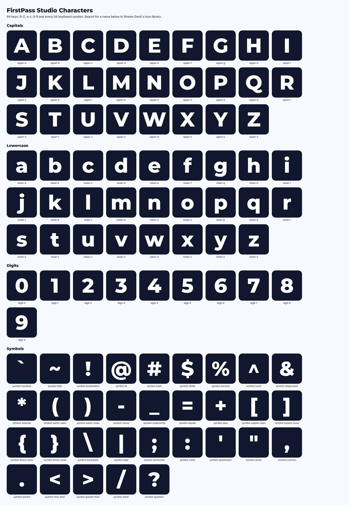

# FirstPass Studio Characters (Stream Deck icon pack)

One key image for every character on a US keyboard, for labelling Stream Deck keys: A-Z, a-z, 0-9 and the 32
symbols (`` ` ~ ! @ # $ % ^ & * ( ) - _ = + [ ] { } \ | ; : ' " , . < > / ? ``). 94 keys in all, white Montserrat
on the navy of the Studio plugin's keys. Every character sits on the same baseline, so `-` and `_`, or `.` and `'`,
keep their places like on a keyboard.



## Install

Double-click `FirstPass Studio Characters.streamDeckIconPack`; the Stream Deck app installs it. Then pick a key's
image from the icon library and search by name: `A (capital)`, `a (lowercase)`, `7`, `# Hash`, or a tag such as
`symbol` or `bracket`.

## Build

```
npm run iconpack
```

Draws every key in Chromium with Playwright (already a dev dependency; set `STUDIO_TEST_CHROMIUM` to use another
Chromium) and writes `dist/iconpack/FirstPass Studio Characters.streamDeckIconPack` and
`dist/iconpack/characters-preview.png`. The pack is a zip of the `.sdIconPack` folder (manifest.json, icons.json,
icons/, previews/, icon.png and the MIT licence). To change the look, edit the colours and `KEY_CSS` in
[`build.js`](build.js) and raise `VERSION` so Stream Deck updates an installed copy.
